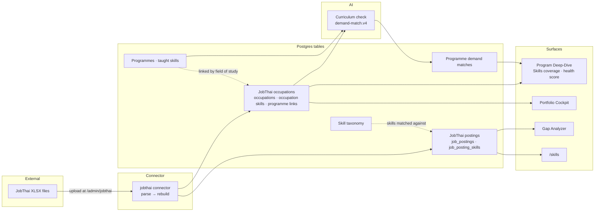

# JobThai — contribution to Program Landscape

**Program Landscape — KKU Curriculum Intelligence Platform** · Khon Kaen University

> This document records what JobThai's job-posting data contributes to this
> application: what the data is, how it moves through the system, how to load
> and manage the XLSX files, what it changes for decision-makers, and why that
> matters for Thai higher education as a whole. It closes with an
> acknowledgement.
>
> Written 2026-09-13 against release v1.9.5. Where a statement could drift, the
> file that implements it is named so it can be re-verified.

> The acknowledgement is also shown inside the application at
> **Reference → Acknowledgements** (`/docs/acknowledgements#jobthai`), where the
> JobThai icon beside any JobThai-derived figure links to it. Entries there come
> from `apps/web/app/docs/acknowledgements/registry.tsx`.

---

## Contents

1. [Acknowledgement](#1-acknowledgement)
2. [Why JobThai data matters here](#2-why-jobthai-data-matters-here)
3. [The data](#3-the-data)
4. [Where the data flows](#4-where-the-data-flows)
5. [Using the XLSX files](#5-using-the-xlsx-files)
6. [What happens to each file](#6-what-happens-to-each-file)
7. [What JobThai data powers](#7-what-jobthai-data-powers)
8. [Method, in brief](#8-method-in-brief)
9. [Privacy and responsible use](#9-privacy-and-responsible-use)
10. [Limitations](#10-limitations)
11. [Contribution to Thai higher education](#11-contribution-to-thai-higher-education)
12. [Reference](#12-reference)

---

## 1. Acknowledgement

Khon Kaen University gratefully acknowledges **JobThai** for providing the
job-posting data that gives Program Landscape its view of **domestic labour
market demand**.

Before JobThai's contribution, the platform's picture of what employers need
came from aggregated, career-level skill statistics. JobThai's postings added
something no other source in the system provides: **employers' own words about
which fields of study they want graduates to hold, at which education level,
in which province and industry.** That is the most direct evidence available
of the link between a university programme and the jobs its graduates enter,
and it now informs how the platform scores programme relevance, which skill
gaps it reports to university leadership, and which occupations each programme
is shown to feed.

Because Program Landscape is made available to Thai universities, JobThai's
contribution reaches beyond Khon Kaen University. The capability it made
possible — reading the Thai job market, in Thai, against Thai curricula — is
part of a platform any Thai university can adopt. JobThai also **intends to make
its data available to other universities that use this application, under a
future memorandum of understanding (MOU) with the Council of University
Presidents of Thailand (CUPT, ที่ประชุมอธิการบดีแห่งประเทศไทย — ทปอ.)**, so that
each can run the same analysis on its own programmes (see
[§11](#11-contribution-to-thai-higher-education)).

> **กิตติกรรมประกาศ** — มหาวิทยาลัยขอนแก่นขอขอบคุณ **JobThai**
> ที่ได้มอบข้อมูลประกาศรับสมัครงาน ซึ่งทำให้ Program Landscape
> สามารถมองเห็นความต้องการของตลาดแรงงานในประเทศได้อย่างเป็นรูปธรรม
> ข้อมูลของ JobThai ระบุโดยตรงว่านายจ้างต้องการผู้สำเร็จการศึกษาสาขาวิชาใด ในระดับวุฒิการศึกษาใด
> ในจังหวัดและอุตสาหกรรมใด ซึ่งเป็นหลักฐานที่ชัดเจนที่สุดของความเชื่อมโยงระหว่างหลักสูตรกับงานที่บัณฑิตเข้าสู่
> และปัจจุบันใช้ประกอบการประเมินความสอดคล้องของหลักสูตร การรายงานช่องว่างทักษะต่อผู้บริหาร
> และการแสดงอาชีพที่แต่ละหลักสูตรป้อนบัณฑิตเข้าสู่ เนื่องจาก Program Landscape
> เปิดให้มหาวิทยาลัยไทยนำไปใช้ได้ และ JobThai มีเจตนาจะเปิดให้มหาวิทยาลัยอื่นที่ใช้ระบบนี้เข้าถึงข้อมูลได้
> ภายใต้บันทึกข้อตกลงความร่วมมือ (MOU) กับที่ประชุมอธิการบดีแห่งประเทศไทย (ทปอ.) ที่จะจัดทำขึ้นในอนาคต
> เพื่อให้แต่ละมหาวิทยาลัยวิเคราะห์หลักสูตรของตนเองด้วยวิธีเดียวกัน การสนับสนุนของ JobThai
> จึงเป็นประโยชน์ต่อการอุดมศึกษาไทยโดยรวม ไม่เฉพาะมหาวิทยาลัยขอนแก่นเท่านั้น

---

## 2. Why JobThai data matters here

Program Landscape exists to help a University Council answer high-stakes
questions — which programmes are misaligned with future skill demand, where the
gaps are, which programmes to revise, merge or launch. Those decisions affect
students and staff, so the evidence behind them has to be defensible.

Labour-market evidence was the weakest link. The existing source describes
skill prevalence by career in aggregate; it cannot say *which degree* an
employer asks for, and its Thai job-posting sample is thin. JobThai postings fill
that gap in four ways:

| What JobThai postings carry | Why it matters for programme decisions |
|---|---|
| **The field of study the employer wants** (e.g. สาขาวิศวกรรมเครื่องกล) | A direct, stated link from a vacancy to a discipline — the basis for linking programmes to occupations without guessing |
| **The minimum education level** (ปวช. / ปวส. / ปริญญาตรี / ปริญญาโท / เอก) | Lets the platform avoid scoring a doctoral programme on bachelor-level vacancies |
| **Province and industry** | National distribution of demand, by sector |
| **The job description and qualification text, in Thai** | The skills employers actually name, in the language they recruit in |

In the platform this is called **domestic demand**, and it is weighted above
global demand (75 : 25) in the programme relevance score.

---

## 3. The data

### Delivery

JobThai delivers postings as **XLSX files**. There is no API: files are
uploaded by the KKU Data Office through the admin page described in
[§5](#5-using-the-xlsx-files).

### Columns

Every file must carry these seven columns, with these exact header names, in
the first sheet:

| Column | Used as |
|---|---|
| `Job Title` | Posting title |
| `Job Category (ประเภทงานหลัก)` | Occupation grouping (with subcategory) |
| `Job Subcategory (ประเภทงานย่อย)` | Occupation grouping (with category) |
| `Business (ประเภทธุรกิจ)` | Industry |
| `Province` | Geography |
| `Job Description (Raw)` | Skill matching |
| `Qualification (Raw)` | Field of study, education level, skill matching |

An optional eighth column, **`Posted Date`**, is accepted automatically when
present. Without it, a posting's date is the date its file was uploaded, and
the platform marks that date as estimated.

Source: `packages/shared/src/jobthai/columns.ts`.

### The 2026-09 delivery, as measured

| | |
|---|---|
| Files | 5 |
| Postings after removing exact duplicates | 47,631 |
| Job categories / subcategories | 44 / 173 |
| Distinct occupations (category × subcategory) | 240 |
| Industries | 41 |
| Provinces | 79 |
| Postings naming a field of study | 40.7% |
| Postings accepting "any field" (ทุกสาขา) | 5.4% |
| Minimum level: bachelor / higher vocational / vocational | 43.0% / 15.1% / 11.8% |
| Minimum level: master's or doctorate | 41 postings |
| No level stated | 30.0% |

These describe that delivery. A later delivery will differ; the platform
recomputes everything from the files currently loaded.

---

## 4. Where the data flows

This mirrors the JobThai portion of the in-app **Application topology**
(`/admin/application-topology`), which shows the same flow with live connector
status.



Everything to the right of the connector is **derived**: it is rebuilt from the
postings that exist at that moment, so adding or removing a file changes it
without any manual step. The AI curriculum check is the one exception — it runs
per programme in the analysis pipeline, because it has a cost per programme.

---

## 5. Using the XLSX files

### Who can do it

Uploading, deleting and viewing files requires an admin-grade account —
**System admin** or **Super admin** — which holds `data_sources:configure`
(`packages/shared/src/auth/permissions.ts`).

### Uploading

1. Sign in and open **Admin → JobThai drops** (`/admin/jobthai`).
2. Choose one or more `.xlsx` files (up to 25 MB each) and upload.
3. The file is checked **immediately**. If a required column is missing, the
   upload is refused on the spot and the message names the missing column —
   the file is never half-loaded.
4. Each accepted file becomes a **batch** marked `PENDING`, and a processing run
   is queued.
5. Usually within a minute the batch turns **`PARSED`** (or **`FAILED`**, with
   the reason shown). The derived layers are then rebuilt, which takes roughly
   ten minutes at about 47,000 postings; the run shows as in progress on
   `/admin/data-sources` until it finishes — see [§6](#6-what-happens-to-each-file).

**Uploading the same file twice does nothing**: files are identified by the
SHA-256 of their bytes, and a duplicate is reported rather than loaded again.

**Uploading several files at once is fine.** Each queues its own run; only one
run proceeds at a time, so the others appear as *skipped* on `/admin/queues`.
That is expected — the run in progress processes every file that arrives while
it is busy.

### Removing a file

Delete the batch from `/admin/jobthai`. Its postings are removed, the stored
file is deleted, and a run is queued that rebuilds occupations, skills and
programme links **from the files that remain**. Occupations that no longer have
any postings are removed.

### Updating to a newer delivery

Upload the new files. If a new delivery **replaces** an older one rather than
adding to it, delete the old batches too — the platform uses every file that is
currently loaded, and does not know which delivery supersedes which.

### After loading: refresh the AI curriculum check

Occupations, demand lists and programme links update automatically. The
per-programme **AI curriculum check** — which decides whether each demanded skill
is taught and how it fits the profession — updates when the analysis pipeline
next runs for a programme. After a substantial new delivery, re-run the pipeline
(or its demand phase) for the programmes you care about. On a production server:

```bash
cd /opt/program-landscape/current
docker compose exec ingestion node dist/scripts/match-program-demand.js KKU-SEQ-0062
```

### Checking what is loaded

```bash
cd /opt/program-landscape/current
docker compose exec -T postgres psql -P pager=off \
  -U "$(cat /opt/program-landscape/secrets/postgres_user)" -d program_landscape <<'SQL'
select status, count(*), sum(row_count) rows_in_files from jobthai_batches group by status;
select (select count(*) from job_postings where source = 'jobthai')  postings,
       (select count(*) from jobthai_occupations)                     occupations,
       (select count(*) from program_jobthai_links)                   programme_links;
SQL
```

### Dry runs and repair (operators)

The rebuild is automatic, but the same code can be run by hand to preview or
repair without writing:

```bash
docker compose exec ingestion node dist/scripts/jobthai-derive.js                 # preview
docker compose exec ingestion node dist/scripts/jobthai-link-programs.js --inspect 12
```

Add `--apply` to write. On a development machine the equivalents are
`pnpm jobthai:derive` and `pnpm jobthai:link-programs`.

---

## 6. What happens to each file

**Parsing** (`packages/shared/src/jobthai/`), within the upload's run:

- Rows are normalised and exact duplicates dropped.
- **Field of study** is read from the qualification text only. In job
  descriptions the word สาขา also means a company *branch*, which would produce
  false disciplines.
- **Minimum education level** is the *lowest* level stated —
  "ปวช., ปวส.- ปริญญาตรี" means a ปวช holder is acceptable.
- "Any field" (ทุกสาขา) is recorded as its own category, not as a discipline.
- Gender and age requirements are discarded; contact details are redacted
  ([§9](#9-privacy-and-responsible-use)).

**Rebuilding** (`apps/ingestion/src/jobthai/refresh.ts`), at the end of the run,
once no file is still waiting:

1. **Occupations** — one per distinct (job category, subcategory) pair.
2. **Skill matching** — each posting's text is matched against the platform's
   skill taxonomy, in Thai and English, deterministically (no AI cost). Latin
   terms are matched on word boundaries; Thai terms, which have no word
   boundaries, need at least five characters.
3. **Occupation demand** — for each occupation, the share of its postings that
   name each skill.
4. **Programme links** — a programme is linked to an occupation when that
   occupation's postings ask for the programme's field of study, at an education
   level its graduates hold.

At about 47,000 postings a rebuild takes roughly ten minutes, almost all of it
skill matching.

---

## 7. What JobThai data powers

| Surface | What JobThai contributes |
|---|---|
| **Program Deep-Dive → Skills coverage** | The **JobThai · domestic** view, shown by default when a programme has JobThai data: the occupations the programme's field feeds, the skills named in those postings, the curriculum's gaps, and degrees employers also accept |
| **Program health score → Relevance** | The `jobthai_demand_alignment` driver — the share of relevant JobThai-demanded skills the curriculum covers — weighted **75 : 25** against LinkedIn (global) demand |
| **Portfolio Cockpit** | Faculty and university relevance roll up from the programme driver |
| **AI curriculum check** | JobThai-demanded skills are checked alongside LinkedIn's, with the programme's JobThai occupations as the target careers for judging profession fit |
| **Skills (`/skills`)** | Recent JobThai postings that name a selected skill |
| **Gap Analyzer** | The job-postings demand path |
| **Application topology** | The JobThai nodes and their connections |

Every surface that shows JobThai data carries the **JobThai logo**.

---

## 8. Method, in brief

The full, versioned methodology is the in-app paper at `/docs/methodology`
(§2.2, §2.3, §4.4) and `docs/methodologies/health-score.md`. In brief:

- **Links come from the stated field of study**, scored as the share of an
  occupation's eligible postings that name it (`jobthai-bridge.v2`). Links below
  0.1, and programmes with fewer than 20 postings behind their links, give no
  signal.
- **Education level is enforced on the posting.** Postgraduate programmes only
  count postings whose stated minimum is postgraduate — so most receive no
  JobThai signal, which the platform reports as a data gap rather than as zero
  demand.
- **A skill is demanded** when at least 5% of the linked postings name it.
  Skills that more than 20% of all occupations ask for (communication,
  management) are shown for context but never counted as gaps.
- **Profession fit** (`demand-match.v4`): an AI check classifies each demanded
  skill as core, supporting, another profession, not relevant, or uncertain, with
  a stated reason. Job adverts list several acceptable degrees, so a skill that is
  itself another discipline — Electrical engineering on a mechanical-engineering
  job — is shown as a degree employers also accept, not as a gap.
- **A JobThai score needs at least five relevant skills**, because a ratio over
  fewer moves too much on one judgement.
- **Domestic 75 : global 25.** Within Relevance, JobThai and LinkedIn demand
  share the weight of two drivers; when one has no data the other takes it all.

---

## 9. Privacy and responsible use

- **Job postings are published advertisements**, not personal data about
  individuals. No employer names are present in the files.
- **Gender and age requirements are discarded when a file is read and never
  stored**, analysed or shown. They appear in roughly half of Thai postings; they
  are not skills, and surfacing them beside programme decisions would be harmful.
- **Email addresses, phone numbers, LINE recruitment IDs and TikTok handles are
  redacted** from stored text.
- Uploaded files are kept in the platform's object storage and are removed when
  their batch is deleted.

Details: `docs/data-sources/jobthai.md`, `docs/pdpa.md`.

---

## 10. Limitations

These travel with every figure derived from JobThai data and are stated in the
application beside those figures.

- **National, not regional.** In the 2026-09 delivery 37% of postings were in
  Bangkok and 3.3% across the 20 Northeast provinces. The data describes the
  Thai labour market as a whole.
- **Little signal for postgraduate programmes**, because very few postings state
  a postgraduate minimum.
- **No salary, employer name or posting date** in the current files, so no
  trend or growth analysis is possible until dated deliveries arrive.
- **Profession fit is an AI judgement** with a stated reason, not a lookup;
  analysts can record disagreement from the page.

---

## 11. Contribution to Thai higher education

Program Landscape is released under **CC BY-NC-SA 4.0** and made available to
Thai universities through KKU (see `docs/adopters/README.md` and `LICENSE`).
JobThai's contribution therefore extends beyond one institution in four ways.

**A reusable national capability.** The hardest part of using job postings for
curriculum decisions is not collecting them — it is reading them correctly:
parsing Thai qualification text, telling a field of study from a company branch,
enforcing education levels, recognising that a listed discipline is an
alternative degree rather than a required skill, and doing it without surfacing
discriminatory requirements. That work was done against JobThai's real data, and
the resulting code and methodology are part of the platform every adopting
university receives.

**A shared vocabulary for programme–labour-market alignment.** Thai universities
report programmes in the same national structures. A method that links a Thai
programme's field of study to the occupations that ask for it, and scores
alignment against the profession rather than against keywords, is directly
relevant to any Thai institution's programme portfolio review, quality-assurance
evidence and Council reporting.

**Evidence that domestic demand belongs in programme decisions.** JobThai's data
made it possible to weight Thai employers' stated needs above global aggregates
in how programme relevance is judged — a position any Thai university adopting the
platform inherits and can adjust.

**Access to the data for other universities (intended, under a future MOU).**
JobThai intends to make its job-posting data available to other universities
that use Program Landscape, on the basis of a future memorandum of understanding
with the **Council of University Presidents of Thailand (CUPT —
ที่ประชุมอธิการบดีแห่งประเทศไทย, ทปอ.)**. The MOU has not yet been concluded;
access, scope and terms will be those it sets. Once in place, it turns the
platform from a KKU capability into a national one: every participating university would see the same domestic
labour market, read by the same method, against its own programmes — so
programme–labour-market evidence becomes comparable across Thai universities
rather than each institution assembling its own.

**How another university would use it.** An adopting university loads the
JobThai XLSX files made available to it through the same admin page
(`/admin/jobthai`), with the same seven columns ([§3](#3-the-data)). Everything
described in [§5](#5-using-the-xlsx-files)–[§8](#8-method-in-brief) then runs on
that university's own programmes: occupations and programme links are built
from the fields of study its programmes teach, the AI curriculum check reads its
own curricula, and the results appear in its own Deep-Dive, Cockpit and health
scores. No code change is needed. The data is not bundled with the platform's
source code; each university would receive it from JobThai under the terms of the
MOU with CUPT.

---

## 12. Reference

| Topic | Where |
|---|---|
| Source specification, measured facts, caveats | `docs/data-sources/jobthai.md` |
| Methodology (public paper, Thai and English) | `/docs/methodology` · `apps/web/app/docs/methodology/content-{en,th}.tsx` |
| Health-score version log | `docs/methodologies/health-score.md` (v5.1, v5.2) |
| Column contract and parser | `packages/shared/src/jobthai/` |
| Upload and delete API | `apps/api/src/jobthai/` |
| Connector and rebuild | `apps/ingestion/src/connectors/sources/jobthai/connector.ts` · `apps/ingestion/src/jobthai/refresh.ts` |
| Programme links and demand | `packages/db/src/jobthai-bridge.ts` · `packages/db/src/jobthai.ts` |
| Curriculum check prompt | `packages/shared/src/ai/prompts/demand-skill-match.ts` |
| Topology | `/admin/application-topology` |
| Adopter guide | `docs/adopters/README.md` |
