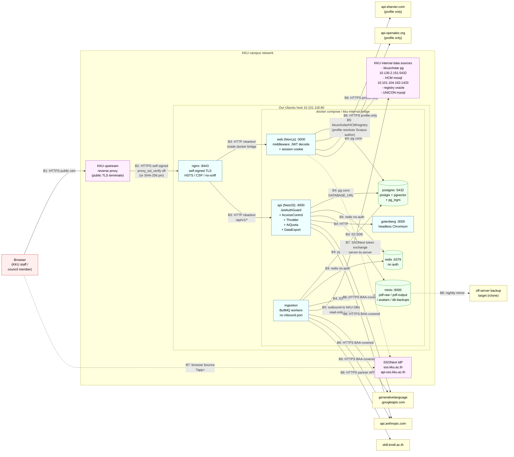

# 01 — Security inventory & threat surface map

> **Mode:** read-only audit. No code changes, no dep upgrades, no test runs.
> **Scope:** every trust boundary, data flow, and asset class in the production system.
> **Sources read:** `docs/production-infrastructure.md`, `docs/architecture.md`, `docs/security-review.md`, `docs/auth/kku-sso.md`, `docs/pdpa.md`, `docker-compose.prod.yml`, `infra/nginx/{nginx.conf,conf.d/program-landscape.conf}`, `apps/api/src/{main,app.module}.ts`, `apps/api/src/common/*`, `apps/web/middleware.ts`, `packages/shared/src/auth/{permissions,roles}.ts`.
>
> Plan: [`01-threat-surface.plan.md`](./01-threat-surface.plan.md).

---

## 0. Snapshot of what's actually deployed

| Item | Value |
|---|---|
| Public URL | `https://program-landscape.kku.ac.th/` |
| Server IP | `10.101.118.80` (KKU internal) |
| Public TLS | Terminated by KKU upstream proxy |
| Internal TLS | Self-signed, our nginx `:8443`, TLSv1.2 + TLSv1.3 only |
| Container runtime | Docker Compose v2, single host, named volumes |
| Compose secrets | postgres_user/password, minio_user/password (file-mounted, mode 0600) |
| App secrets | env_file `.env.prod` (single file, contains `NEXTAUTH_SECRET`, AI keys, all DB creds) |
| Auth | KKU SSO (SSONext custom protocol — NOT OIDC). HS256 JWT in `__Secure-authjs.session-token`. SameSite=Lax. |
| Roles (live) | `SUPER_ADMIN`, `SYSTEM_ADMIN`, `UNIVERSITY_USER`, `FACULTY_USER`, `PROGRAM_USER` |
| Egress posture | Unrestricted from `kku-internal` bridge (compose network is NOT `internal: true`) |

> **Drift caught — `docs/security-review.md` describes the 7-role legacy taxonomy (VIEWER / COUNCIL / DEAN / DEPT_HEAD / EXECUTIVE / ANALYST / ADMIN). The codebase shipped the v2 5-role taxonomy on 2026-05-09. `security-review.md` needs to be re-issued after Block B. Tracked as `TODO(prompt-10)`.**

---

## 1. Asset & data classification

Sensitivity classes:
- **Public** — would be on the website if asked.
- **Internal** — KKU staff-grade.
- **Confidential** — PDPA personal data OR strategic data whose release would hurt KKU's negotiating posture.
- **Restricted** — citizen IDs, salaries, AI prompts/responses with embedded personal data, secrets.

PDPA categories: PII (direct identifier), Sensitive PII (citizen ID / health / financial), Hashed identifier (one-way), Derived (aggregate computed from PII), Non-personal (org structure, public reports).

| Asset / Table family | Where it lives | Sensitivity | PDPA category | Notes |
|---|---|---|---|---|
| **Postgres `users`** (id, email, name, role, faculty/dept/program, employeeId, avatarStorageKey) | Postgres `program_landscape` DB | Confidential | PII | `employeeId` is HR cleartext (captured from SSONext `/auth.token`). Role + scope drives every authz decision. |
| **Postgres `audit_logs`** | Postgres | Confidential | PII (user_id, IP, payload-hash) | 7-year retention per PDPA doc. Append-only. |
| **Postgres `ai_inferences`** | Postgres | Restricted | PII (prompts may contain free text) | 2-year payload retention then redacted. Cron not yet implemented — `TODO(prompt-09)`. |
| **Postgres `faculty_members`** (name, rank, hire/retire dates, dept, employeeCode, salary range bucket) | Postgres | Confidential | PII | Role-gated at Prisma `select` for non-admin roles per CLAUDE.md. Compensation goes to `faculty_compensations` (aggregate-only). |
| **Postgres `faculty_compensations`** | Postgres | Restricted | Derived (HAVING ≥5 enforced at source) | Server-side `GROUP BY ... HAVING COUNT(*) >= 5` in kku-hr connector — single-individual cells never cross the wire. |
| **Postgres `enrollment_metrics`, `student_demographics`** | Postgres | Confidential | Derived (aggregate counts, no per-student row) | Source `kku-registry` aggregates server-side. |
| **Postgres `financial_metrics`, `faculty_budgets`** | Postgres | Confidential | Non-personal | KKU revenue figures — sensitive for negotiating posture, not PDPA. |
| **Postgres `research_outputs`, `publications_caches`** | Postgres | Internal | Non-personal | Public scholarly metadata; author names public per act of publication. |
| **Postgres `pdf_documents` + bytes in MinIO** | Postgres + MinIO `pdf-raw` | Confidential | PII (raw มคอ.2 PDFs may contain citizen IDs in faculty CVs) | `sanitizeAiOutput` scrubs from extraction outputs; raw PDFs remain in MinIO. PDF retention policy not documented — `TODO(prompt-08)`. |
| **MinIO `pdf-output`** | MinIO | Confidential | Derived (aggregates) | Council Pack PDFs — Confidential because of strategic content. |
| **MinIO `avatars`** | MinIO | Internal | PII (face image) | Public-readable via app GET endpoint (no auth on download per `docs/profile-page.md`). |
| **MinIO `db-backups`** | MinIO | Restricted | Mixed (whole-DB pg_dump) | Pre-deploy snapshots. Retention 90 days per `production-infrastructure.md`. Encryption-at-rest deferred — `TODO(prompt-09)`. |
| **Redis BullMQ queues + cache** | Redis | Confidential (transient) | PII (job payloads carry IDs) | `maxmemory 1gb`, `allkeys-lru`. AOF on. No password — `TODO(prompt-09)`. |
| **HCM Thai citizen ID** | NEVER stored | Restricted | Sensitive PII | `HASHBYTES('SHA2_256', ...)` server-side at the KKU HR DB; we receive only the 64-char hex hash. |
| **Self-signed cert + key** | `/opt/program-landscape/certs/` (host bind mount, RO into nginx) | Restricted | N/A (key material) | RSA 4096, 10-year. Mode requires verification — `TODO(prompt-09)`. |
| **Compose secrets** | `/opt/program-landscape/secrets/` (mode 0600, file-mounted) | Restricted | N/A | postgres + minio creds only. AI keys, NEXTAUTH_SECRET, KKU SSO secret are in `.env.prod` (single file, mode 0600 root-owned). Asymmetric posture — `TODO(prompt-09)`. |
| **`.env.prod`** | `/opt/program-landscape/.env.prod` (mode 0600 root) | Restricted | N/A | Contains every other secret — NEXTAUTH_SECRET, KKU_SSO_CLIENT_SECRET, AI keys, KKU DB creds, KMITL keys. Symlinked into release dir. |
| **kkuscholar Postgres connection** | Outbound to `10.130.2.151:5432`, read-only login | Confidential (in transit) | Non-personal payload | TLS posture not configured at our end (the mirror is on the KKU LAN). `TODO(prompt-08)`. |
| **KKU HCM MSSQL connection** | Outbound to `10.101.104.192:1433` | Restricted (HR DB) | PII (citizen-ID hashes flow back) | `KKU_HR_DB_ENCRYPT=false` documented in `.env.prod.example` because the on-network MSSQL isn't TLS-configured. Risk accepted but verify — `TODO(prompt-08)`. |
| **External AI calls** | Outbound HTTPS to Google + Anthropic | Confidential (payloads) | Mixed (prompts may carry program identifiers + extracted PDF text) | Cross-border per PDPA §28. BAA / DPA contractual basis with KKU legal. Verify signed — `TODO(prompt-10)`. |
| **External Scopus/OpenAlex** | Outbound HTTPS to api.elsevier.com + api.openalex.org | Internal | Non-personal | Profile-page only. Public scholarly APIs. |
| **External KMITL Skill Mapping** | Outbound HTTPS to skill.kmitl.ac.th | Internal | Non-personal (aggregate %) | Server-to-server `base64(clientId:secretKey)`. Secret rotation policy needed — `TODO(prompt-09)`. |

---

## 2. Trust-boundary diagram



**Numbered boundaries:**

| # | Crossing | Trust direction | Existing controls |
|---|---|---|---|
| **B1** | Public internet → KKU upstream proxy | untrusted → KKU-trusted | Public TLS (KKU IT) |
| **B2** | KKU upstream proxy → our nginx :8443 | KKU-trusted → app-untrusted | TLSv1.2/1.3, self-signed accepted by KKU proxy. Replay possible — KKU proxy's SourceIP CIDR not yet baked into firewall (placeholder 10/8 + 172.16/12 + 192.168/16 in `nginx.conf:47`). |
| **B3** | nginx → web/api over `kku-internal` bridge | trusted (compose) | Plain HTTP. `X-Forwarded-*` injected. Bridge is shared by ingestion which has no inbound port. |
| **B4** | web/api/ingestion → datastores | trusted (compose) | DATABASE_URL credential. **Redis has no password.** MinIO has root creds via secret files. |
| **B5** | ingestion (+ web for /profile) → KKU intranet DBs | app → KKU DB | Read-only logins. MSSQL `encrypt=false`. Citizen IDs server-side hashed BEFORE projection. |
| **B6** | api/ingestion (+ web for /profile) → public AI/scholarly APIs | app → internet | TLS, vendor BAA/DPA. Egress not whitelisted at host firewall — `TODO(prompt-09)`. |
| **B7** | web ↔ SSONext IdP | app ↔ KKU IdP | TLS to `KKU_SSO_API_BASE`. Secret in `.env.prod`. Browser bounce passes only `?app=<AppID>`. |
| **B8** | MinIO → off-server backup | app → KKU central | rclone/s3-sync. Encryption-at-rest in transit posture not yet documented. `TODO(prompt-09)`. |

---

## 3. STRIDE-lite threat table

> **STRIDE keys:** S=Spoofing, T=Tampering, R=Repudiation, I=InfoDisclosure, D=DoS, E=ElevationOfPrivilege.
> **Status keys:** ✅ existing control adequate, ⚠️ partial / placeholder, ❌ missing → TODO marker.

### B1 — Public → KKU upstream proxy

| STRIDE | Threat | Control | Status |
|---|---|---|---|
| S | Phishing site impersonating `program-landscape.kku.ac.th` | KKU public TLS cert + KKU DNS authority | ✅ |
| D | Volumetric flood from public internet | KKU edge WAF / rate-limit (KKU IT operational, not app) | ⚠️ confirm with KKU IT — `TODO(prompt-10)` |

### B2 — KKU upstream proxy → our nginx :8443

| STRIDE | Threat | Control | Status |
|---|---|---|---|
| S | Internal-network attacker with route to `:8443` impersonates KKU proxy | Host UFW restricts `:8443` to KKU proxy CIDR. Compose binds `0.0.0.0:8443`. **UFW rules not yet applied — `TODO(prompt-09)`.** | ❌ |
| T | MITM on the proxy ↔ us hop | Self-signed TLS + (planned) SHA-256 fingerprint pinning at KKU proxy. Today: `proxy_ssl_verify off` likely. `TODO(prompt-10)` to flip to pinning before Council launch. | ⚠️ |
| I | `set_real_ip_from` placeholder CIDRs (10/8 + 172/12 + 192.168/16 in `nginx.conf:47`) accept spoofed `X-Forwarded-For` from any KKU LAN host | Replace with KKU proxy's real CIDR before go-live (already noted in `kku-network-integration.md`) | ❌ `TODO(prompt-09)` |
| D | Slowloris / TLS-renegotiation against `:8443` | nginx default `keepalive_timeout 65`, `client_body_timeout` not set, `client_header_timeout` not set | ❌ `TODO(prompt-12)` |

### B3 — nginx → web/api over `kku-internal` bridge

| STRIDE | Threat | Control | Status |
|---|---|---|---|
| S | Containers on the bridge impersonate web/api | Compose `container_name`s + DNS scoped to bridge; only nginx exposes ports outside | ✅ |
| T | nginx forwards an attacker-controlled `X-Forwarded-Proto: https` while the request is HTTP | `apps/api/src/main.ts:22` sets `trust proxy: 1` (single hop) which is correct for our 1-hop nginx posture | ✅ |
| I | Plain HTTP between nginx and web/api on bridge | Bridge is in-host kernel namespace; not on the KKU network. Acceptable for v1. Production-grade would need mTLS — `TODO(prompt-10)` (long-term, not blocker) | ⚠️ |
| E | A compromised `gotenberg` could reach back into `web` / `api` over the bridge | Bridge is shared. NestworkPolicy-style segmentation not used. `gotenberg` has no app credentials but can call any internal HTTP. `TODO(prompt-09)` | ❌ |

### B4 — services → datastores

| STRIDE | Threat | Control | Status |
|---|---|---|---|
| S | Foreign container claims to be `api` and connects to Postgres | Postgres role enforces `kku_prod` user + password; on the bridge but only services with the secret can authenticate | ✅ |
| T | SQL injection | 100% Prisma; two `$queryRaw` sites in `benchmarking.ts` + `health-score.ts` + the new `dashboard-overview.ts` factory pattern; all wrap with Zod-validated results | ⚠️ Audit `dashboard-overview.ts` factory thoroughly in prompt 02 — `TODO(prompt-02)` |
| R | Action without audit trail | `@AuditLog()` decorator on every mutating endpoint; `AuditLogInterceptor` is global | ✅ |
| I | Cleartext `DATABASE_URL` in env_file (single `.env.prod`, mode 0600 root) — NOT in compose `secrets:` | `secrets:` only used for postgres_user/password and minio creds; everything else (NEXTAUTH_SECRET, AI keys, KKU SSO secret, KKU DB creds) is in `.env.prod`. Container memory exposure on `docker inspect`. — `TODO(prompt-09)` | ❌ |
| I | **Redis has no password** (`docker-compose.prod.yml:189`) | Bridge-only access mitigates; any compromised container on bridge gets full BullMQ + cache access including queued PDF metadata + AI cost ledger | ❌ `TODO(prompt-09)` |
| D | A misbehaving connector floods BullMQ → Redis OOM | `maxmemory 1gb` + `allkeys-lru` policy will evict cache entries (and possibly queued jobs) under pressure | ⚠️ — `TODO(prompt-12)` to separate cache + queue Redis instances |
| E | Postgres role privilege escalation | `kku_prod` is the application role per `.env.prod.example`; not `postgres` superuser. Verify role permissions — `TODO(prompt-08)` | ⚠️ |

### B5 — ingestion (+ web profile) → KKU intranet DBs

| STRIDE | Threat | Control | Status |
|---|---|---|---|
| S | We connect to a malicious DB at the KKU IP | DB credentials authenticate the server, not the client; we trust the destination IP. Acceptable inside KKU LAN. | ✅ |
| T | Connector executes a write | All connectors use read-only logins per `docs/data-sources/*` specs | ✅ verified per source spec — re-grep in prompt 03 — `TODO(prompt-03)` |
| I | Citizen IDs / salaries / per-student rows accidentally pulled | (a) HCM citizen ID `HASHBYTES('SHA2_256', ...)` server-side; (b) tuition aggregated `GROUP BY ... HAVING COUNT(DISTINCT STUDENTCODE) >= 5`; (c) HR comp aggregated `HAVING COUNT(*) >= 5` | ✅ |
| I | MSSQL connection has `encrypt=false` so cleartext on KKU LAN | Documented in `.env.prod.example`. Risk accepted because mirror is not TLS-configured upstream. Re-confirm with KKU HR-IT — `TODO(prompt-08)` | ⚠️ |
| D | Long-running queries against KKU DBs cause us to hold connections forever | `pg` client default timeout; `KKU_PUBLICATIONS_DB_*` doesn't set `PG_QUERY_TIMEOUT_MS` in `.env.prod.example` — only documented in `apps/ingestion/src/lib/postgres-client.ts` (default 240s). Verify other connectors carry timeouts — `TODO(prompt-11)` | ⚠️ |

### B6 — outbound to public AI / scholarly APIs

| STRIDE | Threat | Control | Status |
|---|---|---|---|
| S | DNS hijack of `api.anthropic.com` etc. | TLS cert validation; we don't pin certs. Standard public CA trust. | ✅ |
| T | A model returns crafted output that triggers prompt injection in the next chain | `sanitizeAiOutput()` scrubber + `checkAnalystSafety()` regex gates on Analyst module. Other modules (gap, scenarios, benchmarking, decisions) trust the system prompt. — `TODO(prompt-10)` | ⚠️ |
| I | Sending PII to vendor (cross-border §28) | `sanitizeAiOutput` scrubs Thai citizen IDs / non-KKU emails / phones from outputs; prompts are designed to use IDs not raw PII. **No automated outgoing-prompt filter** — analyst could paste personal data into Analyst chat input. — `TODO(prompt-10)` | ⚠️ |
| I | API key leak via container logs (pino logger) | `nestjs-pino` redacts `authorization`, `cookie`, `exportReason`. Verify it also redacts AI-key headers — `TODO(prompt-13)` | ⚠️ |
| D | Vendor outage drops Council demo | `wrapWithTransientFallback` in `ai/providers/factory.ts` catches 429/5xx/timeouts → secondary provider | ✅ |
| D | Vendor cost runaway | Per-user daily USD cap via `AiQuotaGuard`; defaults: $1 viewer / $3 exec / $10 admin. Fail-open on DB error. | ✅ |

### B7 — SSONext bounce + token exchange

| STRIDE | Threat | Control | Status |
|---|---|---|---|
| S | Replay of `?code=<uuid>` at our callback | KKU IdP rejects re-used codes; codes expire within seconds | ✅ |
| T | CSRF on the `/api/auth/callback/kku-sso` endpoint | The endpoint accepts only `code` from the IdP; cookie-bearing cross-origin POSTs are blocked by SameSite=Lax. NextAuth's CSRF cookie is double-submitted on standard `/api/auth/*`. | ✅ |
| I | `KKU_SSO_CLIENT_SECRET` in `.env.prod` cleartext | Same posture as DB creds. — `TODO(prompt-09)` to move to compose `secrets:` | ❌ |
| E | First-login provisioning grants too-high role | Default role is `PROGRAM_USER`-grade (lowest); ADMIN elevation is manual via DB. Verify via grep — `TODO(prompt-02)` | ⚠️ |

### B8 — MinIO backup egress

| STRIDE | Threat | Control | Status |
|---|---|---|---|
| T | Backup target tampered → poisoned restore | Pre-deploy snapshot is restore-point. SHA256 not yet generated. — `TODO(prompt-09)` | ❌ |
| I | Backup contains entire DB including PII; encryption-at-rest? | Backup retention 30/90/365 days per `production-infrastructure.md`. Off-server target encryption posture not documented. — `TODO(prompt-09)` | ❌ |

### Cross-cutting (every boundary)

| STRIDE | Threat | Control | Status |
|---|---|---|---|
| R | Operator runs commands in containers without audit trail | No `docker exec` audit; SSH keys ready for `deploy` user only per checklist. KKU bastion access logged at KKU IT. | ⚠️ |
| I | Container image contains baked-in secrets | Multi-stage Dockerfiles with `node:20-alpine` runner; `.env.prod` is mounted at run-time, not baked. Verify no `ARG` carries secrets in Dockerfile — `TODO(prompt-09)` | ⚠️ |
| E | Compromised dev workstation pushes a malicious image | Pack-and-ship from dev WSL2; image bundle SHA256 generated by `scripts/build-release.ts`; deploy script verifies SHA256 before `docker load`. ✅ | ✅ |
| E | Next.js 15 deferral leaves CVEs in the dep tree | Per `security-review.md` §10: 1 critical + 19 high + 24 mod + 5 low at last snapshot. Re-run `pnpm audit` in prompt 02. — `TODO(prompt-02)` | ❌ |

---

## 4. Role catalog (live as of 2026-05-09)

> **Source:** `packages/shared/src/auth/{roles,permissions}.ts`. **Drift:** `docs/security-review.md` is on the legacy 7-role taxonomy; that doc lags by one major refactor (KKU SSO v2, 2026-05-09).

### Role hierarchy

```
SUPER_ADMIN  (everything; only role that can promote SYSTEM_ADMIN)
   │
   └── SYSTEM_ADMIN  (everything except `queues:manage`)
         │
         └── UNIVERSITY_USER  (read-all + risks:measures:edit)
               │
               ├── FACULTY_USER   (read scoped to user's faculty)
               │
               └── PROGRAM_USER   (read scoped to user's program)
```

`SYSTEM_ADMIN` may assign roles up to `SYSTEM_ADMIN` only; `SUPER_ADMIN` may assign any role. Enforced in admin-users service layer.

### Permission matrix (capability summary)

| Permission family | SUPER_ADMIN | SYSTEM_ADMIN | UNIVERSITY_USER | FACULTY_USER | PROGRAM_USER |
|---|---|---|---|---|---|
| Faculties / departments / programs (read all) | ✅ | ✅ | ✅ | ✅ | ✅ |
| `programs:read:own_faculty` | ✅ | ✅ | — | ✅ | — |
| `programs:read:own_program` | ✅ | ✅ | — | — | ✅ |
| `programs:manage:*` | ✅ | ✅ | — | — | — |
| `financials:read:all` | ✅ | ✅ | ✅ | — | — |
| `financials:read:own_faculty` | ✅ | ✅ | — | ✅ | — |
| `financials:read:own_program` | ✅ | ✅ | — | — | ✅ |
| `financials:read:aggregated_only` | ✅ | ✅ | — | ✅ | ✅ |
| `faculty_members:read:*` | ✅ | ✅ | own_faculty: — / all: ✅ | own_faculty | own_program |
| `outcomes:read:*` | ✅ | ✅ | all | all + own_faculty | all + own_program |
| `scenarios:read:all` | ✅ | ✅ | ✅ | ✅ | ✅ |
| `scenarios:create:*` | ✅ | ✅ | — | — | — |
| `scenarios:edit:any` | ✅ | ✅ | — | — | — |
| `decisions:read:all` | ✅ | ✅ | ✅ | ✅ | ✅ |
| `decisions:approve` / `decisions:edit` | ✅ | ✅ | — | — | — |
| `pdf:upload` / `pdf:approve_extraction` | ✅ | ✅ | — | — | — |
| `pdf:generate` | ✅ | ✅ | ✅ | ✅ | ✅ |
| `pdf:admin` | ✅ | ✅ | — | — | — |
| `ingestion:configure` / `:trigger` | ✅ | ✅ | — | — | — |
| `users:manage` | ✅ | ✅ | — | — | — |
| `kku_sso_mapping:manage` | ✅ | ✅ | — | — | — |
| `data_sources:read` / `:configure` | ✅ | ✅ | — | — | — |
| `queues:read` | ✅ | ✅ | — | — | — |
| `queues:manage` | ✅ | — | — | — | — |
| `risks:read:all` | ✅ | ✅ | ✅ | ✅ | ✅ |
| `risks:assess:any` | ✅ | ✅ | — | — | — |
| `risks:measures:edit` | ✅ | ✅ | ✅ | — | — |

**Observations (drift / gaps to address in later prompts):**

- **`pdf:generate` is universal.** Any signed-in user can request any template. No per-template gating (Council Pack should be `UNIVERSITY_USER+`, not `PROGRAM_USER`). — `TODO(prompt-06)`.
- **No `analyst:*` permission family.** AI Analyst module is reachable by all roles — quota guard is the only restraint. `TODO(prompt-10)`.
- **`risks:measures:edit` is granted to UNIVERSITY_USER.** Confirm this matches Council expectation (some shops want measures-edit gated to admin). — `TODO(prompt-02)`.
- **`outcomes:read:all` granted to FACULTY_USER and PROGRAM_USER alongside their scoped variant** — likely intentional (everyone sees university-wide outcomes for context) but worth confirming. — `TODO(prompt-02)`.
- **No `audit:read` permission.** Audit log is admin-only by default but no controller surfaces it — verify `/admin/audit-log` route exists and is gated. — `TODO(prompt-02)`.
- **No `pdpa:dsar` permission.** DSAR endpoint described in `docs/pdpa.md` is admin-only by convention only. — `TODO(prompt-08)`.

---

## 5. TODO markers — feeding into later prompts

Consolidated punch list. Each item maps to the prompt that should land it (Phase B/C/D as labelled in the phase map).

| TODO | Source row | Lands in |
|---|---|---|
| Audit `dashboard-overview.ts` $queryRaw factory pattern for SQL-fragment safety | B4 | prompt 02 |
| Re-run `pnpm audit`; reconcile with `security-review.md` snapshot from 2026-04-24 | Cross-cutting | prompt 02 |
| Verify `outcomes:read:all` granted to scoped roles is intentional | Role catalog | prompt 02 |
| Verify `risks:measures:edit` for UNIVERSITY_USER matches Council expectation | Role catalog | prompt 02 |
| Confirm `/admin/audit-log` controller exists + ADMIN-gated | Role catalog | prompt 02 |
| Confirm first-login provisioning gives lowest-grade role | B7 | prompt 02 |
| Re-grep all 24 connector specs for "read-only login" | B5 | prompt 03 |
| Verify nestjs-pino redacts AI-key headers in addition to authorization/cookie | B6 | (covered by) prompt 13 |
| Document PDF retention policy for `pdf-raw` (raw PDFs may carry citizen IDs) | Asset table | prompt 08 |
| Verify Postgres app role is `kku_prod` (not superuser) | B4 | prompt 08 |
| Reconfirm `KKU_HR_DB_ENCRYPT=false` with KKU HR-IT | B5 | prompt 08 |
| `kkuscholar` connection TLS posture | Asset table | prompt 08 |
| `pdpa:dsar` permission family + DSAR controller gating | Role catalog | prompt 08 |
| Apply UFW rules: `:8443` from KKU proxy CIDR only; SSH from bastion VLAN | B2 / Cross-cutting | prompt 09 |
| Replace `set_real_ip_from` placeholder CIDRs with KKU proxy real CIDR | B2 | prompt 09 |
| Move NEXTAUTH_SECRET, KKU_SSO_CLIENT_SECRET, AI keys, KKU DB creds, KMITL keys from `.env.prod` to compose `secrets:` (or sealed-secret pattern) | B4 / B7 | prompt 09 |
| Set Redis password; close no-auth posture | B4 | prompt 09 |
| Network-segment Gotenberg (it shouldn't reach back into web/api) | B3 | prompt 09 |
| Egress firewall whitelist on host (allow only documented outbound hosts) | B6 | prompt 09 |
| Encryption-at-rest posture for off-server backup target | B8 | prompt 09 |
| SHA256 generation + verification for backup artefacts | B8 | prompt 09 |
| Implement `AiInference` payload-redaction nightly cron (PDPA 2-year window) | Asset table | prompt 09 |
| Verify Dockerfiles don't bake secrets via `ARG` | Cross-cutting | prompt 09 |
| Confirm self-signed cert key file mode + ownership in deploy bundle | Asset table | prompt 09 |
| Per-template `pdf:generate` gating | Role catalog | prompt 06 (or 10 — see phase map) |
| Confirm SHA-256 cert pinning (or `proxy_ssl_verify off`) with KKU IT | B2 | prompt 10 |
| Confirm KKU edge WAF + DDoS posture | B1 | prompt 10 |
| Confirm Google + Anthropic BAA / DPA signed by KKU legal | B6 | prompt 10 |
| Add outgoing-prompt PII filter for Analyst chat input | B6 | prompt 10 |
| Re-issue `docs/security-review.md` for KKU SSO v2 5-role taxonomy | Snapshot | prompt 10 |
| `analyst:*` permission family + module-level role gating | Role catalog | prompt 10 |
| AI output filter beyond Analyst (gap, scenarios, benchmarking, decisions) | B6 | prompt 10 |
| Set nginx `client_body_timeout` + `client_header_timeout` (slowloris) | B2 | prompt 12 |
| Separate cache Redis from queue Redis | B4 | prompt 12 |
| Per-connector outbound DB query timeouts (in-app, not just `pg.statement_timeout`) | B5 | prompt 11 |
| Long-term: mTLS between nginx and web/api on the bridge | B3 | post-launch |
| KMITL secret-key rotation policy | Asset table | prompt 09 |

---

## Acceptance criteria check

> Every external interface listed in `production-infrastructure.md` (every inbound/outbound row, every internal DB) appears in the report with at least one identified threat and one stated mitigation (existing or planned).

| Source row | Where it appears | Threat row | Control |
|---|---|---|---|
| Inbound `:8443` HTTPS from KKU proxy | B2 | S/T/I/D | self-signed TLS + UFW (TODO) + nginx headers |
| Inbound `:8080` HTTP redirect | B2 | T (redirect to HTTPS) | nginx 301 to HTTPS |
| Inbound `:22` SSH from bastion | Cross-cutting | R (operator audit) | KKU bastion logging + UFW (TODO) |
| Outbound `generativelanguage.googleapis.com` | B6 | I/D | sanitizeAiOutput, AI quota, transient fallback |
| Outbound `api.anthropic.com` | B6 | I/D | same |
| Outbound `api.openalex.org` | B6 | T (DNS hijack) | TLS, public CA |
| Outbound `api.elsevier.com` | B6 | I (cross-border profile-only) | profile-page-only path |
| Outbound `10.130.2.151:5432` (kkuscholar) | B5 | T/I | read-only login, TLS-posture TODO |
| Outbound `10.101.104.192:1433` (HCM) | B5 | I (encrypt=false) | server-side hash on citizen ID, encrypt=false TODO |
| Outbound `10.101.106.44:3310` (UNICON staff) | B5 | I | covered by B5 generic row |
| Outbound `10.130.2.156:3306` (registry mysql) | B5 | I | covered by B5 generic row |
| Outbound Oracle (KKU_REGISTRY_DB_*) | B5 | I | server-side aggregate ≥5 |
| Outbound `skill.kmitl.ac.th/api/v1` | B6 | I | secret rotation TODO |
| Outbound `fonts.gstatic.com` (build-time only) | — | not in runtime threat model | — |
| Postgres :5432 | B4 | T/I/D/E | Prisma + role + bridge isolation |
| Redis :6379 | B4 | I/D | bridge isolation; **no password — TODO** |
| MinIO :9000 | B4 / B8 | I (backup) | compose secrets; encryption-at-rest TODO |
| Gotenberg :3000 | B3 | E (bridge access) | network-segment TODO |

✅ All inbound rows, all outbound rows, all four internal datastores covered. All 24 TODO markers map to a Phase B/C/D prompt.
