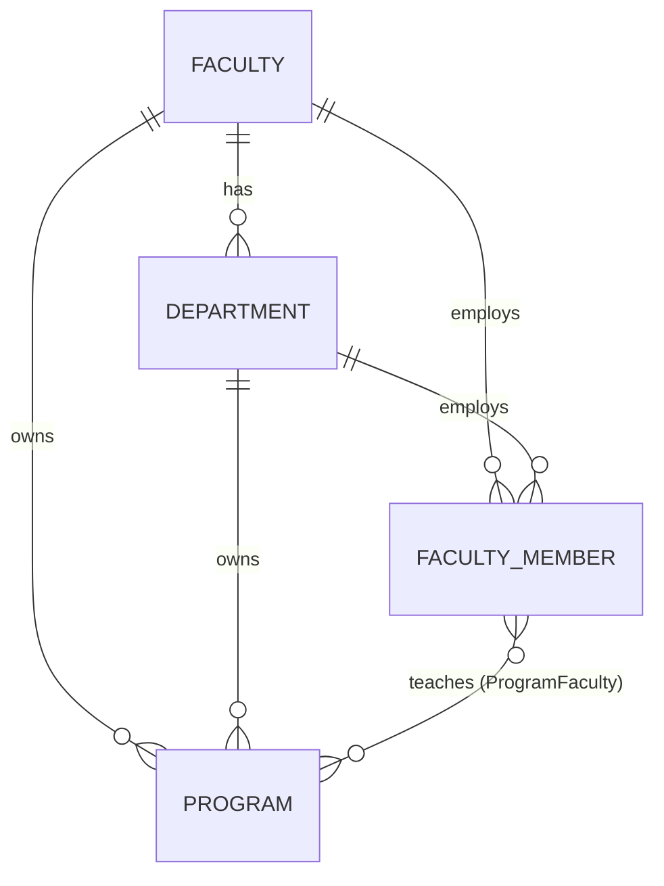
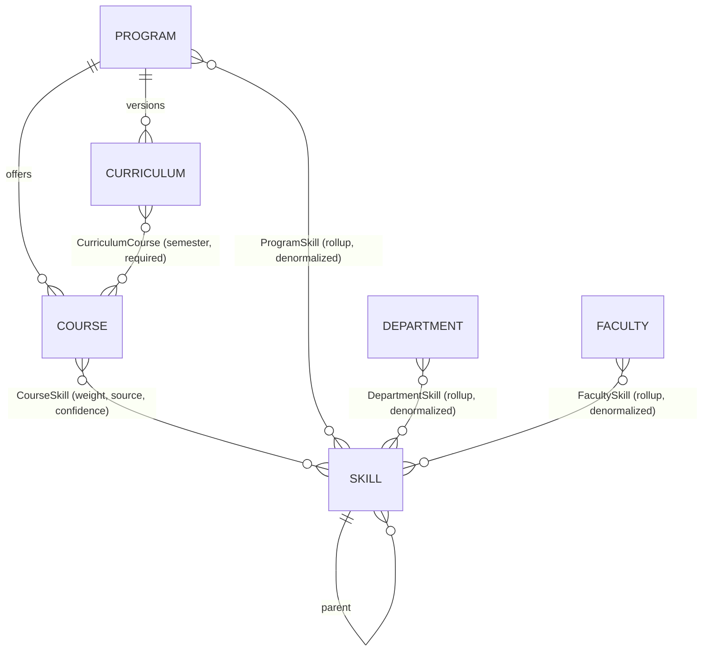
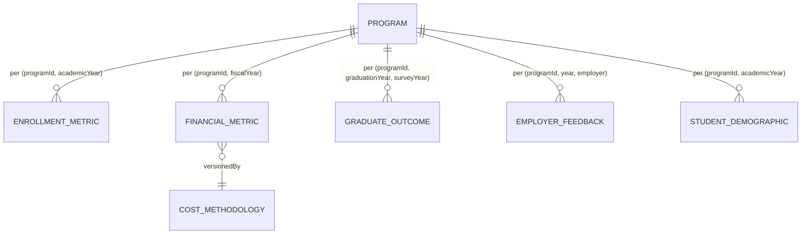
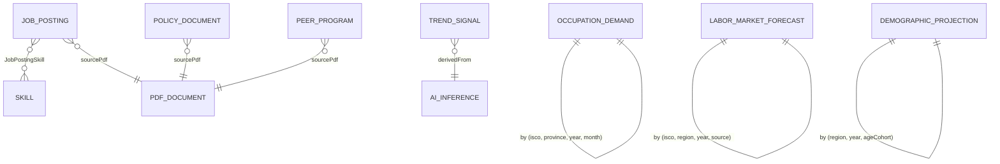
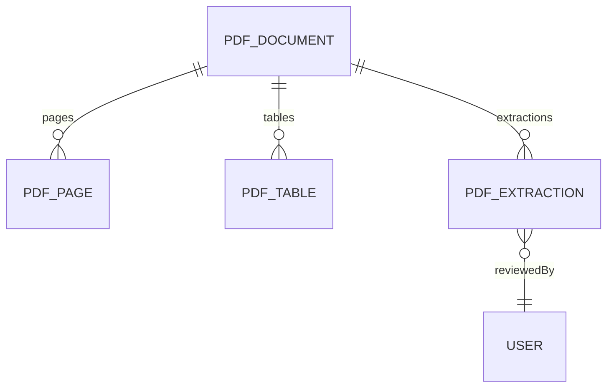
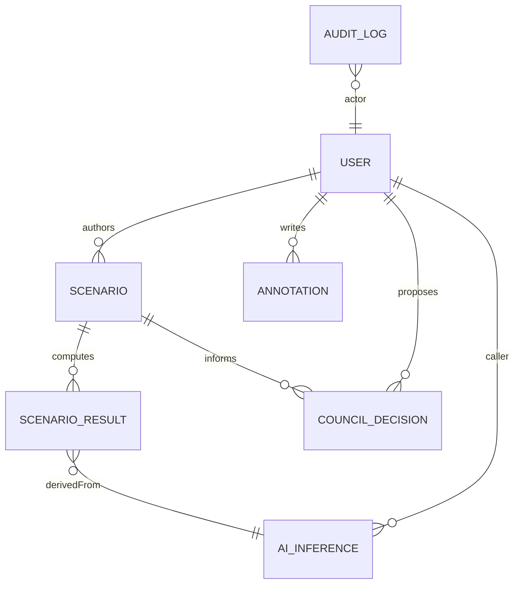

# `@kku/db`

Prisma schema, migrations, seed, and the **scope-aware query helper** that
every other package uses for cross-program rollups.

This package is the single source of truth for the data model. If a module
needs a new metric, the table lands here first.

## Running

```bash
pnpm db:up         # start postgres (docker)
pnpm db:migrate    # apply pending migrations
pnpm data-sources:sync --apply  # create data_sources rows
pnpm db:seed:kku   # populate KKU dev data (db:seed = generic reference seed)
pnpm db:reset      # drop + migrate + seed (dev only)
```

Prisma Studio:

```bash
pnpm --filter @kku/db studio
```

## Data model overview

### Organizational hierarchy



University ← Faculty ← Department ← Program is the canonical scope ladder. Every
analytical query resolves to one of these four levels.

### Curriculum + skills



Course-level skills are authoritative. `ProgramSkill` / `DepartmentSkill` /
`FacultySkill` are **denormalized rollup tables** refreshed by ingestion
jobs (prompt 04) — not materialized views — because skill aggregation is a
weighted union of curriculum memberships, not a simple SUM.

### Metric tables (granular, program-scoped)



Every metric row carries:

- `freshnessDate` — the observation window end date (shown in
  `<FreshnessBadge>`).
- `methodologyVersion` — lets us show "v2 methodology" in the provenance
  drawer and keep old rows intact when the formula changes.

### External signals



### PDF infrastructure (primary external input)



### Decisions & governance



## Scope aggregation strategy

### The problem

Every analytical view in the app can be viewed at four scopes:
**university / faculty / department / program**. The UI, the API, and the AI
Analyst all speak this vocabulary. The data model must make rollups cheap
and consistent.

### The design

Store **metric rows at the most granular level (program)**. Roll up through
**materialized views** for the three higher scopes. All modules read rollups
via a single helper (`queryMetricByScope`) — never with ad-hoc joins
scattered through module code.

```
enrollment_metrics (program-level source of truth)
  ├→ mv_program_metrics        (pass-through, unified row shape)
  ├→ mv_department_metrics     (SUM by department_id)
  ├→ mv_faculty_metrics        (SUM by faculty_id)
  └→ mv_university_metrics     (SUM, single 'kku' row per year)
```

All four MVs share the same column shape. The unified `year` column pulls
from `academic_year` / `fiscal_year` / `graduation_year` in the underlying
tables. A row exists for every (scope_id, year) pair that has at least one
metric family present — metrics that don't apply are `NULL`.

### Why materialized views, not plain views

- Rollups are read-heavy; every dashboard render hits them.
- Underlying metric rows mostly append (ingestion drops a new year's batch).
- Concurrent refresh is allowed because every MV has a unique index.

### Refresh order (bottom-up)

```
1. REFRESH MATERIALIZED VIEW CONCURRENTLY mv_program_metrics;
2. REFRESH MATERIALIZED VIEW CONCURRENTLY mv_department_metrics;
3. REFRESH MATERIALIZED VIEW CONCURRENTLY mv_faculty_metrics;
4. REFRESH MATERIALIZED VIEW CONCURRENTLY mv_university_metrics;
```

Triggered by ingestion jobs (prompt 03) once a metric batch commits. The
helper `refreshMetricViews()` in `src/scope.ts` runs all four in order.

### Weighted averages

`employment_rate_weighted` and `average_salary_weighted` use
`sample_size` as the weighting column — not a simple `AVG()` — because a
program with 500 graduates surveyed should not count the same as one with
12.

### Skill rollups (different strategy)

Skill weight aggregation is not a SUM — it's a weighted-union operation
sensitive to curriculum membership and course weight. That is handled by
denormalized tables (`program_skills`, `department_skills`, `faculty_skills`)
updated by an ingestion job, not by a materialized view.

## The one entry point for rollups: `queryMetricByScope`

```ts
import { queryMetricByScope } from '@kku/db';

const rows = await queryMetricByScope({
  scope: 'faculty',
  scopeId: 'clxyz...',                  // omit for 'university'
  family: 'enrollment',                 // or 'financial' | 'outcomes'
  years: { from: 2022, to: 2024 },      // optional
});
```

Returns `MetricRow[]` — a Zod-validated array of rows with the uniform MV
column shape. Modules never touch the MVs directly.

## Adding a new metric

1. Add the metric table to `schema.prisma` with `freshnessDate`,
   `methodologyVersion`, and appropriate indexes.
2. `pnpm --filter @kku/db prisma migrate diff --from-schema-datasource prisma/schema.prisma --to-schema-datamodel prisma/schema.prisma --script > migrations/<ts>_new_metric/migration.sql`
   *(or `migrate dev` in an interactive shell)*.
3. Extend the four MVs (SQL migration) to pull from the new table.
4. Extend `MetricFamilySchema` in `src/scope.ts` and the row schema.
5. Update `seed.ts`.
6. Document the methodology in `docs/methodologies/<metric>.md`.

## Embeddings (pgvector)

Columns typed `Unsupported("vector(1536)")` (Skill, JobPosting,
PolicyDocument, PeerProgram, PdfDocument, PdfPage) are **not** readable or
writable through Prisma Client. They're written and queried via
`prisma.$queryRaw` in the ingestion / AI layers (prompts 03, 04).

Seed leaves them NULL; ingestion populates them.

## Extensions (managed by Prisma)

The datasource block declares the required extensions:

```prisma
extensions = [postgis, vector, pg_trgm, btree_gin, uuidOssp(map: "uuid-ossp")]
```

With `previewFeatures = ["postgresqlExtensions"]` in the generator, the
first migration emits `CREATE EXTENSION IF NOT EXISTS` for each. The
`infra/postgres/init/01-extensions.sql` file runs once on volume creation
as a belt-and-braces fallback — both are idempotent.

## Conventions

- **Table names:** `snake_case` via `@@map`. Model names: camelCase.
- **Columns:** `camelCase` in Prisma, `snake_case` on disk via `@map`.
- **FK behaviour:** `onDelete: Restrict` for org-hierarchy links (never
  silently lose programs), `Cascade` for nested children (curricula delete
  with program), `SetNull` for governance/audit refs (preserve history when
  a user is deleted).
- **Every entity** has `createdAt` + `updatedAt`, except pure link tables
  and append-only log rows (createdAt only).
- **Every metric row** has `freshnessDate` + `methodologyVersion`.
- **Embeddings** are nullable and written out-of-band via raw SQL.
- **No string-concat SQL.** Raw queries go through `Prisma.sql` tagged
  templates + Zod validation of results.

## Test data

The seed produces (deterministically, via `mulberry32(20260422)`):

- 5 faculties · 12 departments · 30 programs
- 30 curricula · 210 courses · 500 skills · 628 course-skill links
- 60 faculty members · program assignments
- 90 enrollment rows · 90 financial rows · 60 graduate-outcome rows
  (3 years × 30 programs; outcomes only for years with enough gap to
  survey)
- 50 job postings · 5 PDF document fixtures · 9 data-source stubs
- 7 users (one per role: VIEWER / COUNCIL / EXECUTIVE / DEAN / DEPT_HEAD /
  ANALYST / ADMIN)

Re-run with `pnpm db:seed:kku`. Upserts are keyed on natural columns, so the
seed is idempotent.
